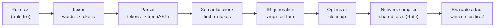

# BULC Rule Engine

BULC lets you write business rules in plain, readable text and turns them into a fast network that decides which rules fire for an incoming event.

```
rule HighValueRisky priority 10 {
    when amount > 10000 AND risk_score > 80
    then block_transaction
}
```

Give the engine an event such as `{ amount: 25000, risk_score: 90 }` and it answers: **"HighValueRisky fires, so run `block_transaction`."**

It is built like a small compiler: the rule text goes through several stages, each one doing a single job, and the output is a shared network that is efficient to evaluate.

## How it works in one picture



Details of each stage are in [docs/compiler-pipeline.md](docs/compiler-pipeline.md), and a full walk-through with a real example is in [docs/workflow.md](docs/workflow.md).

## Project status

| Part | Folder | Status |
|------|--------|--------|
| Lexer, parser, AST | `backend/compiler/lexer`, `parser` | Done, tested |
| Semantic checker | `backend/compiler/semantic` | Done, tested |
| IR + optimizer | `backend/compiler/ir`, `optimizer` | Done, tested (optimized and unoptimized results are compared) |
| Network compiler + simple evaluator | `backend/compiler/network` | Done, no dedicated tests yet |
| Runtime (working memory, agenda, executor) | `backend/runtime` | Not started |
| HTTP API | `backend/api` | Not started (contract drafted in [docs/api.md](docs/api.md)) |
| Frontend | `frontend/` | Working UI, runs on a **mock** compiler until the API exists |

## Repository layout

```
backend/
  compiler/      the compiler stages (C++17)
  examples/      sample .rule files (fraud, insurance, firewall)
  tests/         unit tests for each stage
frontend/        React + Vite user interface
docs/            architecture, workflow, language and API docs
```

## Quick start

### Backend (compiler and tests)

Requires a C++17 compiler (g++ or clang++). From the `backend` folder:

```bash
SRC="compiler/lexer/lexer.cpp compiler/parser/parser.cpp compiler/semantic/semantic_checker.cpp compiler/ir/ir.cpp compiler/optimizer/optimizer.cpp compiler/network/rete_compiler.cpp"

g++ -std=c++17 -I. $SRC tests/lexer_tests/lexer_tests.cpp -o lexer_tests && ./lexer_tests
g++ -std=c++17 -I. $SRC tests/semantic_tests/semantic_tests.cpp -o semantic_tests && ./semantic_tests
g++ -std=c++17 -I. $SRC tests/optimizer_tests/optimizer_tests.cpp -o optimizer_tests && ./optimizer_tests
g++ -std=c++17 -I. $SRC tests/parser_tests/examples_test.cpp -o examples_test && ./examples_test examples/fraud_rules.rule examples/insurance_rules.rule examples/firewall_rules.rule
```

Each should print `all tests passed`. More detail in [backend/README.md](backend/README.md).

### Frontend

```bash
cd frontend
npm install
npm run dev
```

Open the address Vite prints (usually http://localhost:5173).

## Documentation

| Doc | What it explains |
|-----|------------------|
| [docs/architecture.md](docs/architecture.md) | The big picture: components, data flow, design choices |
| [docs/workflow.md](docs/workflow.md) | One rule followed step by step through every stage |
| [docs/rule-language.md](docs/rule-language.md) | The rule language: grammar, operators, limitations |
| [docs/compiler-pipeline.md](docs/compiler-pipeline.md) | The compiler stages and optimizations |
| [docs/api.md](docs/api.md) | The planned HTTP API used by the frontend |
