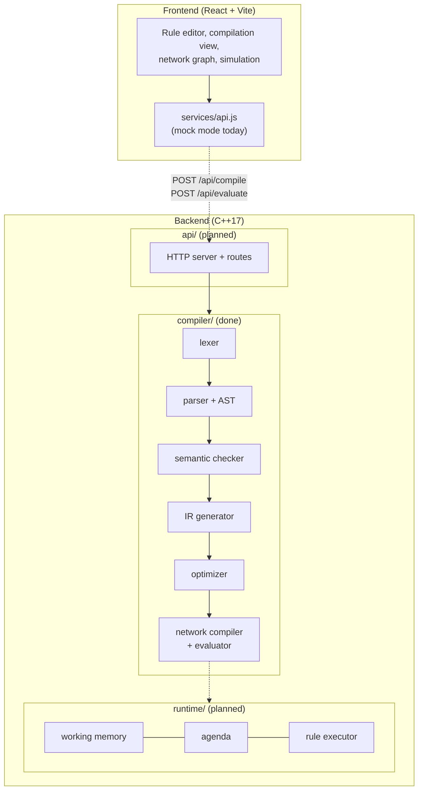
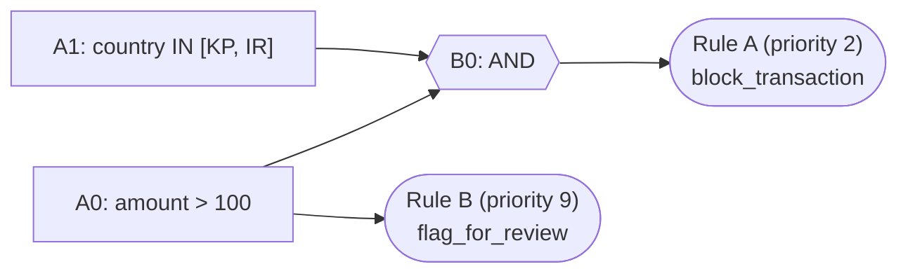

# Architecture

This page explains how BULC is put together and why, in plain terms.

## The idea

Business rules are usually written as "if this and that, then do something". Checking every rule one by one against every event is slow, and rules often repeat the same checks (many rules ask `amount > 100`).

BULC solves this like a programming-language compiler:

1. People write rules in a readable language.
2. The compiler checks them, simplifies them, and builds one shared network of checks.
3. At run time an event flows through the network. Each check is done once, even if ten rules need it.

## Components

Solid boxes inside `compiler/` exist and are tested. Dotted arrows are connections that are planned but not built yet.

## Data that flows between stages

Each stage takes one kind of data and produces the next. Nothing skips ahead.

| Stage | Input | Output | Why it exists |
|-------|-------|--------|---------------|
| Lexer | text | tokens (`amount`, `>`, `10000`, ...) | the parser should not care about spaces or comments |
| Parser | tokens | AST (a tree) | captures structure: which `AND`/`OR`/`NOT` group together |
| Semantic check | AST | errors and warnings | catch mistakes (wrong types, unknown action) before they cause trouble |
| IR generator | AST | IR (simple tree of tests) | one small, uniform shape that is easy to optimize |
| Optimizer | IR | smaller IR | remove double `NOT`, duplicates, merge `OR` of equals into `IN` |
| Network compiler | IR | network of alpha and beta nodes | share identical checks between rules |
| Evaluator | network + a fact | rules that fire | answer "what should happen for this event" |

## The network, explained simply

Two kinds of nodes:

- **Alpha node**: one single check on one field, for example `amount > 100`. Identical checks from different rules become the *same* alpha node.
- **Beta node**: combines earlier results with `AND`, `OR` or `NOT`. Identical combinations are shared too.
- **Terminal**: the end of a rule. If its node is true, the rule fires and its actions are listed, highest priority first.

Rule B needs only `amount > 100`. Rule A needs `country IN [...] AND amount > 100`. Both use alpha node A0, so `amount > 100` is evaluated once per event. During evaluation each node's answer is remembered so it is never computed twice.

## Frontend

The frontend has four pages: Dashboard, Rules, Compiler and Simulation. Its components show the compiler's output: the rule editor, token and IR view (`CompilationView`), the network drawing (`NetworkGraph`), the step-by-step evaluation (`ExecutionTrace`) and the final answer (`ResultPanel`).

All backend calls go through one file, `frontend/src/services/api.js`. It has a **mock mode** (the default) that fakes a compiler in JavaScript, so the UI works with no backend. When the C++ server exists, set `VITE_USE_MOCK=false` and `VITE_API_URL=http://localhost:8080` in `frontend/.env` and the same UI talks to the real compiler.

## Design choices

- **One job per stage.** Easier to test: each stage has its own test program.
- **Simplify before sharing.** The optimizer runs before the network is built, so equivalent tests end up identical and get shared.
- **Safe optimization.** The optimizer test checks that optimized and unoptimized rules fire for exactly the same facts.
- **Errors carry positions.** Every token and AST node keeps a line and column, so messages can point to the exact place in the rule.

## Current limits

- The runtime (working memory, agenda, action execution) and the HTTP API are not written. `Network::evaluate` is a basic evaluator that answers "which rules fire for this one fact".
- `within 60s` time windows are parsed and stored but not enforced yet.
- The frontend's mock compiler always shows a sample network, not one built from your text.
- See [rule-language.md](rule-language.md) for language limits.
