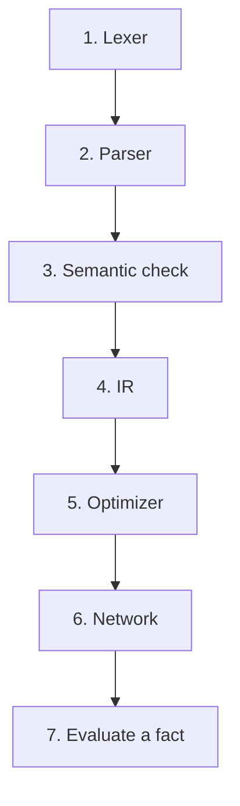
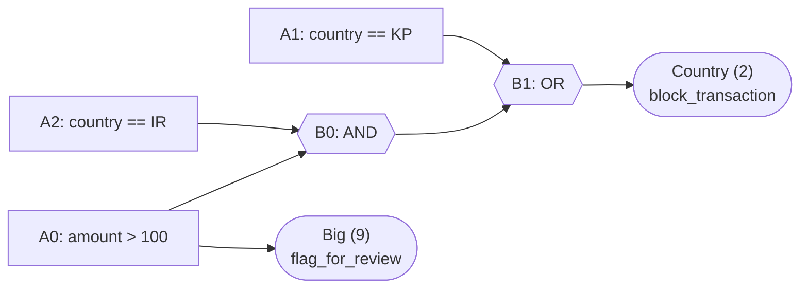

# Workflow: one rule, start to finish

This page follows two small rules through every stage of the compiler. All the output shown is real, produced by the code in this repository.

The rules:

```
rule Big priority 9 {
    when NOT (NOT (amount > 100)) AND amount > 100
    then flag_for_review
}

rule Country priority 2 {
    when country == "KP" OR country == "IR" AND amount > 100
    then block_transaction
}
```



## 1. Lexer: cut the text into pieces

The lexer reads characters and groups them into tokens, skipping spaces and `#` comments. For `amount > 100 AND country == "KP"`:

```
identifier(amount)  >  number(100)  AND  identifier(country)  ==  string(KP)  end-of-file
```

Bad input is rejected here: a lone `=`, an unterminated string, or a character like `@` raises a `LexError` with the line and column.

## 2. Parser: build the tree

The parser turns the flat token list into a tree that shows what groups with what. Operator strength is **NOT, then AND, then OR**, like in most programming languages.

```
Big:     AND( NOT( NOT( amount > 100 ) ), amount > 100 )
Country: OR( country == "KP", AND( country == "IR", amount > 100 ) )
```

Look at `Country`: because AND is stronger than OR, the rule means "country is KP, **or** (country is IR **and** amount > 100)". If you meant "(KP or IR) and amount > 100", add parentheses:
`(country == "KP" OR country == "IR") AND amount > 100`.

Grammar mistakes (missing `then`, unbalanced brackets, a dangling `AND`) raise a `ParseError` here.

## 3. Semantic check: catch mistakes the grammar allows

The text can be well-formed and still make no sense. This stage reports:

- **Errors**: `amount > "x"` (ordered comparison needs a number), a field used as a number in one place and text in another, an empty or mixed-type `IN` list, duplicate rule names, a rule with no actions, an action with the wrong number of arguments.
- **Warnings**: a negative priority, an action name the checker doesn't know.

If there are errors, the pipeline stops. Our two rules produce none.

## 4. IR generation: one simple shape

The tree is rewritten into the IR (intermediate representation): only tests, `AND`, `OR` and `NOT`. Comparisons become `field operator value` tests. Here the IR looks like the tree above because the rules are already simple.

## 5. Optimizer: clean up without changing meaning

The optimizer removes redundancy. For rule `Big`:

```
before:  AND( NOT( NOT( amount > 100 ) ), amount > 100 )
after:   amount > 100
```

- `NOT NOT x` becomes `x`, leaving `AND(x, x)`.
- `x AND x` becomes `x`.

Result: **10 nodes down to 6**. The optimizer also turns `f == a OR f == b` into `f IN [a, b]` and sorts rules by priority (highest first).

The test suite proves the optimizer is safe: it evaluates the unoptimized and optimized rules over a large set of generated facts and requires identical answers.

## 6. Network: share the checks

Every distinct test becomes one **alpha node**; every distinct combination becomes one **beta node**; each rule ends at a **terminal**.

```
Alpha nodes:
  A0: amount > 100       used by [Big, Country]
  A1: country == "KP"    used by [Country]
  A2: country == "IR"    used by [Country]
Beta nodes:
  B0: AND(A2, A0)
  B1: OR(A1, B0)
Terminals:
  Big     (priority 9) <- A0 => flag_for_review
  Country (priority 2) <- B1 => block_transaction
```



`amount > 100` appears in both rules but is a single node (A0), so it is checked once per event.

## 7. Evaluate a fact

A **fact** is an event: a set of field values. For `{ amount: 250, country: "KP" }`:

1. A0 is true (250 > 100), A1 is true, A2 is false.
2. B0 = A2 AND A0 = false. B1 = A1 OR B0 = true.
3. Terminals: `Big` is true and `Country` is true.
4. Fired, highest priority first: **Big (9), then Country (2)**.

A field missing from the fact makes any test on it false.

## Where each step lives

| Step | Code | Test |
|------|------|------|
| 1 Lexer | `compiler/lexer` | `tests/lexer_tests` |
| 2 Parser | `compiler/parser` | `tests/semantic_tests` (malformed syntax), `examples_test` |
| 3 Semantic | `compiler/semantic` | `tests/semantic_tests` |
| 4 IR | `compiler/ir` | covered by `optimizer_tests` |
| 5 Optimizer | `compiler/optimizer` | `tests/optimizer_tests` |
| 6-7 Network | `compiler/network` | `examples_test` (builds it); no dedicated tests yet |

## How the frontend fits in

The frontend shows these same stages as screens: rules go into the editor, the Compiler page shows tokens, IR before/after and the network graph, and the Simulation page lets you enter a fact and watch it flow through the network. Today it uses a built-in mock compiler. Once the C++ API exists, it will call the real one. See [api.md](api.md).
